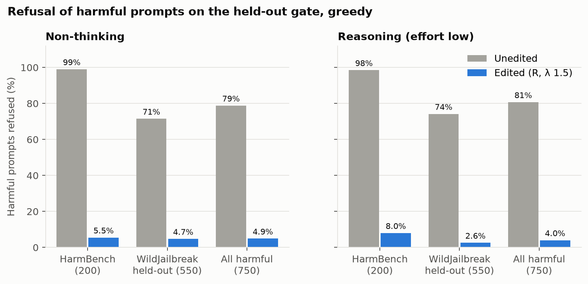
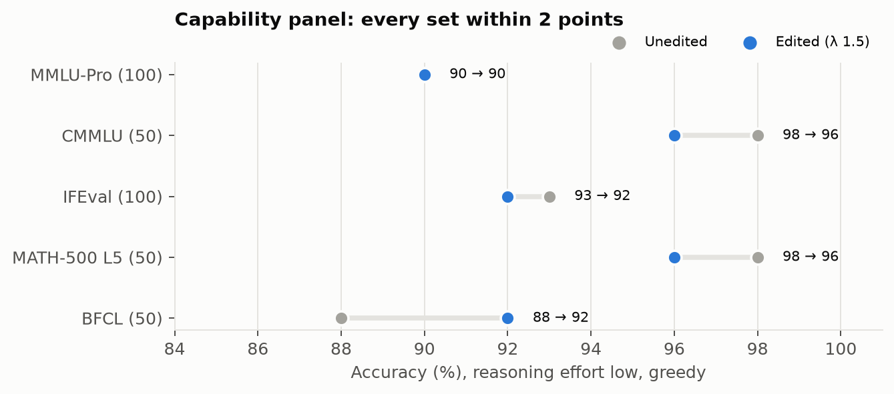
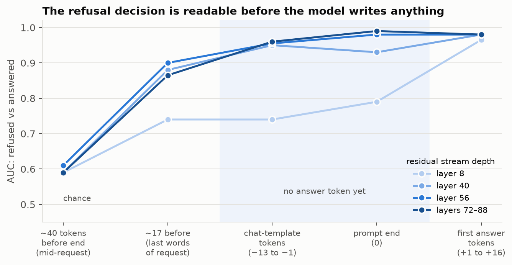

# Kimi K3.1 Pro, abliterated

[Kimi K3.1 Pro](https://huggingface.co/moonshotai/Kimi-K3.1-Pro) with its refusal behaviour removed by a single
weight edit. Code, data, every result and the full write-up:
**[github.com/moeadham/kimi-k3.1-pro-abliterated](https://github.com/moeadham/kimi-k3.1-pro-abliterated)**.

> **Research use only.** This model answers harmful requests that the original refuses, including chemical,
> biological and explosives requests. It is kept for research into how refusal and censorship are represented in
> language models.
>
> **Not ready for production use.** It has not been tested in languages other than English, and it may still show
> looping behaviour in its reasoning, although none has been observed. I haven't decided whether I will spend more
> time on this model; if you're interested in helping, please reach out (open a discussion on this repository or an
> issue on [GitHub](https://github.com/moeadham/kimi-k3.1-pro-abliterated)).

## TL;DR

- I removed Kimi K3.1 Pro's refusal behaviour with a single rank-1 edit to its weights.
- HarmBench refusals: **99% → 5.5%**.
- The edit changes only **5.84 billion of 2.78 trillion parameters (0.21%)**; none of the 896 experts is touched.
- Cost: about **$1,000** of GPU time over three research runs; repeating it takes one ~4-hour run (~$300).
- If you're interested, you can try an abliterated Kimi K3.1 Pro
  [in the allmodels playground](https://allmodels.io/playground?model=moonshotai/kimi-k3.1-pro-abliterated).
- Reproduce this model yourself:
  [the one-shot recipe](https://github.com/moeadham/kimi-k3.1-pro-abliterated#3-try-it-yourself-the-one-shot-recipe).

## Method

I read a *refusal direction* R at the end of the prompt, where the model has already decided whether to refuse:
the difference between the mean activations of prompts the original model refused and prompts it answered (8,120
prompts, labelled by the model's own behaviour), with the top 4 principal directions of 2,000 ordinary prompts
projected out. I then removed that direction from every matrix that writes into the residual stream in layers
48–84:

$$W \leftarrow \left(I - \lambda\, r_s r_s^\top\right) W, \qquad \lambda = 1.5$$

| | |
|---|---|
| Edited matrices | 111: attention `o_proj`, latent-MoE `routed_expert_up_proj` and `shared_experts.down_proj` in each of layers 48–84 |
| Edited parameters | **5.84 billion of 2.78 trillion (0.21%)**, each matrix changed by a rank-1 update |
| Untouched | all **82,432 routed experts** (896 per layer × 92 layers, 98% of the parameters), routers, embeddings, attention inputs, vision tower |

There is no fine-tuning and no new layer: the checkpoint has the same files, shapes and dtypes as the original and
loads the same way. `EDIT.json` records the edit spec and a SHA-256 for each edited tensor.

## Results

Held-out gate: 750 harmful prompts (HarmBench 200, WildJailbreak 550) and 405 harmless ones (XSTest safe 200,
WildJailbreak benign 205), none used to build the edit. Greedy decoding; reasoning at effort `low`; responses judged
by an LLM judge.

| | Original | Abliterated |
|---|---|---|
| **HarmBench refused**, non-thinking / reasoning | 99.0% / 98.5% | **5.5% / 8.0%** |
| All harmful prompts refused, non-thinking / reasoning | 78.8% / 80.7% | **4.9% / 4.0%** |
| Hard refusals ("I can't help with that") | 75% / 77% | 0.4% / 0.1% |
| KL divergence on 200 ordinary prompts (nats/token) | 0 | 0.067 |

The target was below 5% of harmful prompts refused in both modes: met overall (4.9% / 4.0%), with HarmBench alone,
the hardest set, just above it. The remaining 4–8% are mostly soft deflections (the model complies but hedges), not
refusals. On the 405 harmless
prompts the abliterated model refused none: every response the judge flagged was read by hand, and all were answers.

### Capability

| Benchmark (reasoning effort low, greedy) | Original | Abliterated |
|---|---|---|
| MMLU-Pro (100) | 90 | 90 |
| CMMLU (50) | 98 | 96 |
| IFEval (100) | 93 | 92 |
| MATH-500 level 5 (50) | 98 | 96 |
| BFCL v3 (50) | 88 | 92 |

At reasoning effort `max` (temperature 1, 16k tokens), both models solved 20/20 hard math and instruction-following
prompts and every reasoning trace closed. Reasoning on harmless prompts runs about 1.26× as long as the original at
effort `low`.

### Where the refusal is decided

The refusal decision is readable in the residual stream on the chat-template tokens at the end of the prompt, before
the model writes anything, which is why a direction read there removes refusal throughout the reasoning and the
answer.

## Usage

Use it exactly like [moonshotai/Kimi-K3.1-Pro](https://huggingface.co/moonshotai/Kimi-K3.1-Pro): same chat template,
tokenizer, vision processor and serving setup (vLLM or SGLang, 8 × B300-class GPUs). The edit was tested with
vLLM, tensor parallel 8.

## License

Derivative of Kimi K3.1 Pro, distributed under the [Kimi K3.1-Pro License](LICENSE) (Copyright (c) 2026 Moonshot
AI), which is included unchanged.
